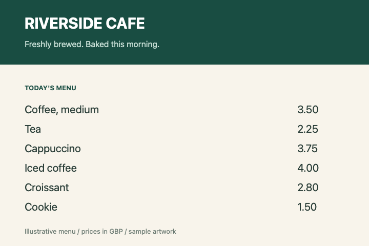

# Sample data

These are original, illustrative fixtures created for the console examples, with
real file encodings and realistic structures. The café, sales, sensor readings,
expenses, and protocol records are fictional. The assets contain no customer
records or credentials and require no downloads. The workshop URL uses the
reserved `example.com` domain; it is a sample payload, not a live event page.

## Viewable files

### Café menu PNG

[cafe-menu.png](images/cafe-menu.png) is a 720 × 480 RGBA image with menu text and
prices matching the CSV. [cafe-menu.svg](images/cafe-menu.svg) is an editable vector
version of the same design. `PngImages` reads the PNG, inspects pixels, and verifies
that decoding and re-encoding preserve the image.

### Workshop QR code

[workshop-qr.png](qr/workshop-qr.png) is a 296 × 296 PNG encoding
`https://example.com/workshops/library-day`. It uses a Model 2, version 3 symbol,
medium error correction, eight pixels per module, and a four-module quiet zone.
`QrCodes` detects and decodes this image, checks its text against
[workshop-url.txt](qr/workshop-url.txt), and generates a new PNG with the local
`qrcode` and `png` libraries. Keep both files in sync when changing the payload.

### Progress animation

[loading-progress.gif](images/loading-progress.gif) contains three 240 × 80 frames
showing 20%, 60%, and 100% progress. Their delays are 300, 300, and 800 milliseconds;
the animation loops indefinitely. It was created with the local `gif` library.
`GifAnimation` verifies that its decoded pixels and timing survive re-encoding.
`ImageFormats` identifies all three raster files by their bytes.

## Editable text and structured inputs

| File | Consumer | Contents and expected result |
| --- | --- | --- |
| [cafe-sales.csv](cafe-sales.csv) | `CsvJson` | Six sales with order IDs, dates, quantities, prices, and a quoted product name; total **40.60**. |
| [expenses.json](expenses.json) | `Spreadsheet` | Three expense records deserialized into C# records; workbook total **73.50**. |
| [opening-checklist.json](opening-checklist.json) and [checklist.template](checklist.template) | `TemplateReport` | Typed checklist with two completed tasks and one pending task, rendered using a loop, conditionals, and an include. |
| [sensor-reading.json](sensor-reading.json) | `CborMessages` | Cold-room sensor ID, timestamp, temperature, humidity, online status, and recent samples. |
| [service-settings.yaml](service-settings.yaml) | `YamlSettings` | Service settings with regions and nested health/logging options; replicas change from two to three. |
| [river-walk.geojson](river-walk.geojson) | `GeoJsonRoutes` | Illustrative three-point route near the Thames, with descriptive properties; not surveyed navigation data. |
| [workshop.html](workshop.html) | `HtmlExtraction` | Complete workshop page with headings, a list, emphasis, and a link. |
| [weekly-report.md](weekly-report.md) | `MarkdownReport` | Café status report with a table, task list, and link. |
| [catalog.xml](catalog.xml) | `XmlDocuments` | Three books with IDs, prices, and titles containing escaped characters. |
| [sales-report.sql](sales-report.sql) | `SqlQueries` | Sales aggregation with grouping, filtering, and ordering; parsed without a database. |
| [order-request.http](protocols/order-request.http) | `HttpMessages` | HTTP POST headers and a five-byte body (`hello`); intentionally no newline after the body. |
| [service-options.sip](protocols/service-options.sip) | `SipMessages` | SIP OPTIONS request with addressing, transaction headers, and an empty body. |
| [audio-session.sdp](protocols/audio-session.sdp) | `SessionDescriptions` | Audio offer with two payload formats and a documentation-only IP address. |
| [domain-record.txt](protocols/domain-record.txt) | `WhoisRecords` | Fictional WHOIS fields, including two name servers. |

Build copies these files beside each executable under `data/`; the apps resolve
inputs from their executable directory. Edit the originals here and rebuild to
try a change. Protocol apps normalize text to CRLF before parsing. Generated
images and workbooks go into the ignored `artifacts/` directory, leaving the
source fixtures intact.
